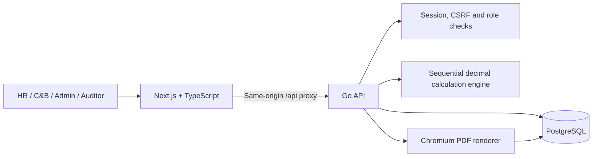
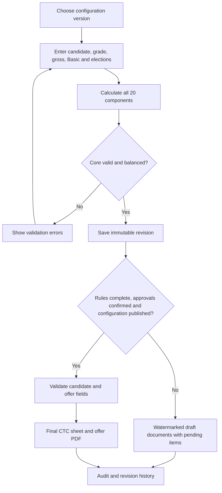
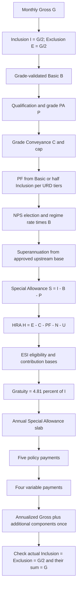
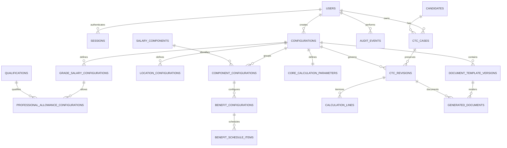

# Architecture and data model

This describes the implemented demo. Business values come from the URD or explicit configuration; the architecture and access model are technical decisions.

## Runtime

The frontend displays server-calculated decimal strings. The backend validates and recalculates when saving; client totals are never trusted. The engine is independent of HTTP, database and PDF code. PostgreSQL retains masters, snapshots, document bytes and audit events. The local deployment uses three containers; the test deployment has its own database and API.

## Business flow

## Calculation sequence

PF is `0.12 * B` if `B > 25000`; otherwise `0.12 * min(0.5 * I, 25000)`. NPS is zero when opted out, otherwise `0.14 * B` in the new regime or `0.10 * B` in the old regime. These are seeded URD parameters, not a substitute for payroll-law or Finance approval.

At the URD illustration `G=100000, B=20000, P=0, C=7300, NPS=new/on, U=0`, PF=3000, NPS=2800, S=30000 and H=36900. Both groups total 50000; Gratuity=2405. Known annual subtotal is 1228860. Final CTC remains unknown until missing components are resolved. PF, NPS and Superannuation are already within Gross and are not added twice.

Missing policy values remain null/pending; explicit non-applicability is separate from missing data. Benefit operations accept only permitted upstream bases, eliminating arbitrary or circular formulas. Annual and one-time payouts are not misleadingly presented as recurring monthly salary. The demo supports manual Basic, half-up rounding at 0-2 decimal places and a confirmed full 12-month annualization convention. Other methods and proration need client rules and implementation review.

## Entity relationships

The executable schema in `backend/internal/app/schema.sql` is the column-level authority. Financial columns use `numeric(24,8)`; calculation inputs/results are also preserved as JSON snapshots. Composite foreign keys prevent a grade, location or component from a different configuration version being attached to a revision. Unique keys identify revision numbers and one PDF per revision/type/mode. Timestamps use `timestamptz`; users, configurations, revisions, generated documents and audit events carry actor/time information appropriate to their lifecycle.

Configuration JSON and typed child rows are written in one transaction. Revisions, configuration data and audit history are protected against application rewrites. A new master edit creates a new version. Document templates and generated bytes remain linked to the saved revision, with a checksum. Private object storage can replace database PDF bytes when production volume warrants it.

## Modules and permissions

| Module | Implemented experience | Access |
| --- | --- | --- |
| Candidate CTC generation | Single screen with candidate profile, elections, all salary groups, parity and pending items | HR, C&B, Admin |
| Records and candidate profile | Search, saved profile, revision snapshots, continue as next revision, PDFs | HR own records; C&B/Admin/Auditor all |
| Master configuration | Grades, PA slabs, Conveyance/cap, locations, statutory/retirement parameters, eligibility, payments, schedules, templates and confirmations | C&B edits; other roles read |
| CTC and offer documents | HTML preview and PDF from saved revision; draft/final validation | Authorized record readers |
| Audit | Search and inspect immutable events | HR own events; other roles all |
| User management | Create, change role, reset password, deactivate; session revocation | Admin |

The generator is the default workspace. A separate analytics dashboard was a proposed module, not an explicit URD requirement. Candidate profile and salary breakdown are integrated rather than duplicated as separate screens. These choices preserve the URD's single-screen HR workflow.

## Production transition

1. Demo foundation: containers, database, role-aware sessions and versioned masters — implemented.
2. Calculation and workflow: sequential rules, candidate revisions, parity, pending-rule handling — implemented.
3. Documents and management: templates, PDFs, audit and users — implemented.
4. Acceptance: engine/API/browser checks and requirement traceability — results in `verification.md`.
5. Client validation: supply salary annexures, payment rules, rounding/annualization, HRA approval and official offer wording; execute signed acceptance cases.
6. Production deployment: select hosting; corporate identity if required; TLS, managed secrets, backups/restore testing, migration process, monitoring, retention and load targets. These operational integrations are future work.

Effective dates are stored, but users explicitly choose the rule version. Automatic date selection and conflict precedence require client confirmation. Local password authentication is complete for the demo; corporate OIDC is not yet integrated. No production tax, payroll, ATS integration or reverse-CTC feature is implied.
